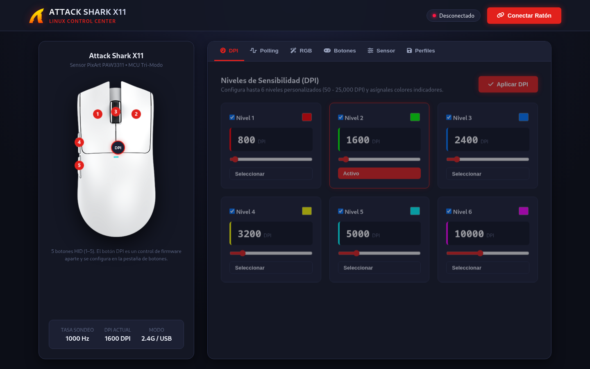

# Attack Shark X11 Control Center

**Centro de configuración para Linux**

[English](README.md) | **Español**


Controlador nativo y suite de configuración completa para el ratón gamer **Attack Shark X11**, diseñado para funcionar en cualquier distribución Linux moderna sin Wine ni emuladores.

Construido realizando ingeniería inversa del firmware y software oficial de Windows mediante la metodología de [REA (Reverse Engineer Anything)](https://rea.tools/es/).



> **Nota:** "X11" en el nombre del producto es el modelo del ratón, no el servidor gráfico X11. La aplicación funciona tanto en sesiones **Wayland** como **X11**.

---

## 🖱️ Compatibilidad

| Dispositivo / modo                             | Estado                                                                           |
| :--------------------------------------------- | :------------------------------------------------------------------------------- |
| Attack Shark X11 — receptor 2.4G (`1d57:fa60`) | Verificado en hardware real                                                      |
| Attack Shark X11 — USB por cable               | Soportado por la implementación del protocolo; se agradecen reportes de hardware |
| Attack Shark X11 — Bluetooth                   | La configuración por Bluetooth no está expuesta; usa 2.4G o USB                  |
| Base de carga RGB                              | No configurable por HID; usa su botón táctil                                     |
| Otros modelos Attack Shark                     | Sin soporte oficial; abre un issue con el PID y el descriptor de reportes        |

---

## 🎮 Características Soportadas

- **Ajuste de DPI:**
    - Hasta 6 niveles configurables en la interfaz (el firmware soporta 8) entre **50 y 25,000 DPI**.
    - Codificación no lineal real del sensor PAW3311; soporta la escala doble/triple del firmware.
    - Colores LED indicadores personalizados para cada nivel.
    - Selección en tiempo real del nivel activo.
- **Tasa de Sondeo (Polling Rate):**
    - Selección instantánea de **125 Hz (8ms)**, **250 Hz (4ms)**, **500 Hz (2ms)** o **1000 Hz (1ms)**.
- **Iluminación RGB:**
    - 7 modos reales del X11 (Apagado, Estático, Respiración, Neón, Respiración Multicolor, DPI fijo y DPI respirando).
    - Selector de color de 24 bits (16.8 millones de colores) y paleta rápida.
    - El color personalizado se aplica en **Estático** y **Respiración**. **Neón** y **Respiración Multicolor** usan colores automáticos del firmware. **DPI fijo** y **DPI respirando** usan el color asignado al nivel de DPI activo.
    - Si pulsas el botón físico de DPI mientras hay otro modo activo, el firmware muestra brevemente el color del nuevo nivel; la aplicación restaura tu modo elegido al cabo de un segundo.
    - Control de velocidad (1 a 5) y brillo (1 a 8).
    - La **base de carga RGB es independiente**: no expone un canal HID de configuración. Sus efectos se cambian con el botón táctil de la base (pulsación corta) y se apagan con una pulsación larga.
- **Sensor & Rendimiento Competitivo:**
    - Distancia de despegue (LOD): **0.7 mm**, **1 mm** o **2 mm**.
    - Sincronización **Motion Sync**, **Angle Snapping** y **Ripple Control**.
    - El anti-rebote (Key Debounce) no está expuesto por HID en este modelo; se conserva solo en el perfil local.
- **Gestión de Energía:**
    - Lectura de batería por eventos asíncronos del firmware (no por sondeo de Feature Reports).
    - Temporizador de suspensión profunda.
    - El apagado de LEDs por inactividad no está expuesto por HID en este modelo.
- **Mapeo de Botones:**
    - Reasignación de los **5 botones HID estándar** (izquierdo, derecho, rueda, adelante y atrás).
    - El botón superior de DPI se configura en una sección avanzada aparte: es un control de firmware, no un sexto botón HID.
- **Gestión de Perfiles:**
    - Guardado persistente automático.
    - Exportación e importación de perfiles en formato `.json`.

---

## 🛡️ Seguridad y recuperación

- Al conectar, la aplicación **no envía ningún comando automáticamente**. La lectura de la configuración es opcional mediante el botón **«Leer ratón»**.
- Todas las operaciones se serializan y se espacian al menos 150 ms; las lecturas usan el permiso de un solo uso del firmware (`0xA0`) y comprueban su respuesta.
- Si el ratón deja de responder tras un comando, **desconecta y vuelve a conectar el receptor 2.4G**. En modelos con Bluetooth, también puedes cambiar brevemente a Bluetooth y volver a 2.4G.
- No se debe enviar el reporte `0x10`: está relacionado con el modo bootloader.

---

## 🧰 Solución de problemas

| Problema                                              | Qué revisar                                                                                                                                                                |
| :---------------------------------------------------- | :------------------------------------------------------------------------------------------------------------------------------------------------------------------------- |
| El dispositivo no aparece en el selector WebHID       | Usa Helium, Chrome, Chromium, Brave o Edge. Cierra otras pestañas que puedan tener el dispositivo abierto, recarga con `Ctrl+Shift+R` y conecta el receptor 2.4G.          |
| "Permiso denegado" o no se puede abrir el dispositivo | Ejecuta `./install.sh` o `sudo ./setup_udev.sh`, y desconecta y vuelve a conectar el receptor. Comprueba que tu usuario puede leer los nodos `/dev/hidraw*`.               |
| El ratón deja de responder                            | Desconecta y vuelve a conectar el receptor 2.4G. En modelos con Bluetooth, cambia brevemente a Bluetooth y vuelve a 2.4G. No envíes reportes desconocidos.                 |
| La batería muestra `--%`                              | La batería llega de forma asíncrona por la interfaz de eventos. Si el navegador no concede esa interfaz, el valor simplemente no está disponible; no se sondea por `0x0B`. |
| Solo veo 5 botones                                    | Es correcto: el X11 expone 5 botones HID estándar. El botón DPI es un control de firmware aparte y aparece en "Avanzado".                                                  |
| El RGB de la base de carga no cambia                  | La base tiene su propio controlador y botón táctil; no se configura con el protocolo del ratón.                                                                            |
| La aplicación no abre                                 | Ejecuta `./run.sh` desde una terminal para ver el error. También puedes abrir `index.html` directamente en un navegador con WebHID.                                        |
| Nada funciona tras actualizar el kernel               | Reconecta el receptor, vuelve a ejecutar `./install.sh` y comprueba que la regla udev está en `/etc/udev/rules.d/`.                                                        |

---

## 🚀 Inicio Rápido

### Requisitos

- Linux con `udev`
- Python 3.10 o superior
- Un navegador basado en Chromium con soporte WebHID: Helium, Google Chrome, Chromium, Brave o Microsoft Edge

### Paso 1: Clonar e instalar

```bash
git clone https://github.com/Alan-sastre/attack-shark-x11-linux.git
cd attack-shark-x11-linux
chmod +x install.sh
./install.sh
```

El instalador configura los permisos udev y añade **"Attack Shark X11 Control Center"** al menú de aplicaciones con la ruta correcta.

_(Opcional: desconecta y vuelve a conectar el receptor 2.4G para aplicar los permisos de inmediato)._

Si prefieres configurar solo los permisos USB manualmente:

```bash
sudo ./setup_udev.sh
```

---

### Paso 2: Iniciar la Aplicación Gráfica (WebHID)

#### Opción A: Desde tu lanzador de aplicaciones

Busca **"Attack Shark X11 Control Center"** en GNOME, KDE, Rofi, Wofi o tu menú habitual.

#### Opción B: Desde la terminal

```bash
./run.sh
```

Esto iniciará el servidor local y abrirá la aplicación en **Helium Browser** o tu navegador Chromium compatible.

#### Opción C: Abrir `index.html` directamente

Si tu navegador soporta WebHID, también puedes abrir el archivo `index.html` sin usar el servidor local.

---

## 💻 Control desde la Terminal (CLI)

El proyecto incluye también un script en Python (`shark_ctl.py`) para usuarios avanzados o scripts de automatización:

```bash
# Ver estado del ratón (modo 2.4G/USB y tasa de sondeo):
python3 shark_ctl.py status

# Cambiar tasa de sondeo a 1000 Hz:
python3 shark_ctl.py polling 1000

# Cambiar sensibilidad a 1600 DPI:
python3 shark_ctl.py dpi 1600

# Cambiar iluminación a color rojo estático:
python3 shark_ctl.py rgb --mode 1 --color "#ff0000" --brightness 6 --speed 4
```

---

## 📂 Estructura del Proyecto

```text
attack-shark-x11-linux/
├── index.html                   # Interfaz gráfica principal (WebHID Control Center)
├── css/
│   └── style.css                # Diseño visual gamer / cyberpunk con dark mode
├── js/
│   ├── app.js                   # Lógica de interfaz y gestión de estado
│   ├── protocol.js              # Codificador/Decodificador del protocolo HID
│   └── webhid.js                # Gestor de conexión y comunicación WebHID
├── assets/
│   ├── mouse.png                # Render oficial en alta resolución del X11
│   ├── screenshot.png           # Captura de la interfaz gráfica
│   ├── icon.png                 # Icono oficial de Attack Shark
│   └── buttons/                 # Pines indicadores numerados
├── shark_ctl.py                 # CLI nativo en Python para terminal y scripts
├── server.py                    # Servidor local ligero con auto-arranque de navegador
├── run.sh                       # Lanzador rápido
├── install.sh                   # Instalador de udev + acceso directo
├── setup_udev.sh                # Instalador de reglas udev
├── 99-attack-shark-x11.rules    # Reglas udev para Vendor ID 0x1d57
├── Attack-Shark-X11.desktop     # Plantilla del acceso directo
├── REVERSE_ENGINEERING.md       # Dossier técnico completo del protocolo
├── REVERSE_ENGINEERING.es.md    # Dossier técnico en español
├── CONTRIBUTING.md              # Guía para contribuir (inglés)
├── CONTRIBUTING.es.md           # Guía para contribuir (español)
├── SECURITY.md                  # Política de seguridad (inglés)
├── SECURITY.es.md               # Política de seguridad (español)
├── LICENSE                      # Licencia MIT
├── README.md                    # Guía principal (inglés)
└── README.es.md                 # Esta guía en español
```

---

## 🔍 Detalles de Ingeniería Inversa

Para ver la especificación técnica completa de los paquetes USB HID, los identificadores de reporte (`0x04`, `0x05`, `0x06`, `0x08`, `0x09`, `0x0B`, `0xA0`) y los algoritmos de verificación, consulta el archivo [REVERSE_ENGINEERING.es.md](REVERSE_ENGINEERING.es.md).

---

## 🤝 Contribuir

Las contribuciones son bienvenidas. Antes de enviar un pull request, lee
[`CONTRIBUTING.es.md`](CONTRIBUTING.es.md) y ejecuta las comprobaciones de sintaxis
indicadas allí. Para problemas de seguridad, consulta [`SECURITY.es.md`](SECURITY.es.md).

---

## 📄 Licencia

Distribuido bajo la licencia **MIT**. Consulta [`LICENSE`](LICENSE) para más
detalles.

Este es un proyecto no oficial y no está afiliado a Attack Shark. Las marcas y
los recursos gráficos pertenecen a sus respectivos propietarios.
