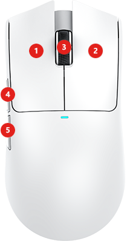

# Attack Shark X11 Control Center

**A native Linux control center for the Attack Shark X11 gaming mouse**

**English** | [Español](README.es.md)


A native driver and full configuration suite for the **Attack Shark X11** gaming mouse, designed to work on any modern Linux distribution without Wine or emulators.

Built by reverse engineering the firmware and the official Windows software using the [REA (Reverse Engineer Anything)](https://rea.tools/) methodology.



---

## 🎮 Supported Features

- **DPI adjustment:**
  - Up to 6 configurable levels in the UI (the firmware supports 8) from **50 to 25,000 DPI**.
  - True non-linear PAW3311 sensor encoding, including the firmware's double/triple scale.
  - Custom LED colors for each level.
  - Real-time selection of the active level.
- **Polling rate:**
  - Instant selection of **125 Hz (8 ms)**, **250 Hz (4 ms)**, **500 Hz (2 ms)** or **1000 Hz (1 ms)**.
- **RGB lighting:**
  - 7 real X11 modes (Off, Static, Breathing, Neon, Color Breathing, Static DPI and Breathing DPI).
  - 24-bit color picker (16.8 million colors) and quick palette.
  - Speed control (1 to 5) and brightness control (1 to 8).
  - The **RGB charging dock is independent**: it does not expose a HID configuration channel. Its effects are changed with the dock's touch button (short press) and turned off with a long press.
- **Sensor & competitive performance:**
  - Lift-off distance (LOD): **0.7 mm**, **1 mm** or **2 mm**.
  - **Motion Sync**, **Angle Snapping** and **Ripple Control**.
  - Key debounce is not exposed over HID on this model; it is kept only in the local profile.
- **Power management:**
  - Battery level is read from asynchronous firmware events (not by polling Feature Reports).
  - Deep-sleep timer.
  - LED inactivity shutdown is not exposed over HID on this model.
- **Button mapping:**
  - Remap the **5 standard HID buttons** (left, right, wheel, forward and back).
  - The top DPI button is configured in a separate advanced section: it is a firmware control, not a sixth HID button.
- **Profile management:**
  - Automatic persistent saving.
  - Export and import profiles in `.json` format.

---

## 🛡️ Safety and recovery

- On connect, the application **does not send any commands automatically**. Reading the configuration is optional through the **"Read mouse"** button.
- All operations are serialized and spaced by at least 150 ms; reads use the firmware's single-use permission handshake (`0xA0`) and verify its response.
- If the mouse stops responding after a command, **unplug and reconnect the 2.4G receiver**. On models with Bluetooth, you can also briefly switch to Bluetooth and back to 2.4G.
- Never send report `0x10`: it is related to bootloader mode.

---

## 🚀 Quick Start

### Requirements

- Linux with `udev`
- Python 3.10 or newer
- A Chromium-based browser with WebHID support: Helium, Google Chrome, Chromium, Brave or Microsoft Edge

### Step 1: Clone and install

```bash
git clone https://github.com/TU-USUARIO/attack-shark-x11-linux.git
cd attack-shark-x11-linux
chmod +x install.sh
./install.sh
```

The installer configures the udev permissions and adds **"Attack Shark X11 Control Center"** to the application menu with the correct path.

*(Optional: unplug and reconnect the 2.4G receiver to apply the permissions immediately.)*

If you prefer to configure only the USB permissions manually:

```bash
sudo ./setup_udev.sh
```

---

### Step 2: Launch the graphical application (WebHID)

#### Option A: From your application launcher

Search for **"Attack Shark X11 Control Center"** in GNOME, KDE, Rofi, Wofi or your usual menu.

#### Option B: From the terminal

```bash
./run.sh
```

This starts the local server and opens the application in **Helium Browser** or your compatible Chromium browser.

#### Option C: Open `index.html` directly

If your browser supports WebHID, you can also open the `index.html` file without using the local server.

---

## 💻 Terminal Control (CLI)

The project also includes a Python script (`shark_ctl.py`) for advanced users and automation:

```bash
# Show mouse status (2.4G/USB mode and polling rate):
python3 shark_ctl.py status

# Set the polling rate to 1000 Hz:
python3 shark_ctl.py polling 1000

# Set sensitivity to 1600 DPI:
python3 shark_ctl.py dpi 1600

# Set static red lighting:
python3 shark_ctl.py rgb --mode 1 --color "#ff0000" --brightness 6 --speed 4
```

---

## 📂 Project Structure

```text
attack-shark-x11-linux/
├── index.html                   # Main graphical interface (WebHID Control Center)
├── css/
│   └── style.css                # Gamer / cyberpunk visual design with dark mode
├── js/
│   ├── app.js                   # UI logic and state management
│   ├── protocol.js              # HID protocol encoder/decoder
│   └── webhid.js                # WebHID connection and communication manager
├── assets/
│   ├── mouse.png                # Official high-resolution X11 render
│   ├── icon.png                 # Official Attack Shark icon
│   └── buttons/                 # Numbered indicator pins
├── shark_ctl.py                 # Native Python CLI for terminals and scripts
├── server.py                    # Lightweight local server with browser auto-launch
├── run.sh                       # Quick launcher
├── install.sh                   # udev + desktop-entry installer
├── setup_udev.sh                # udev rules installer
├── 99-attack-shark-x11.rules    # udev rules for Vendor ID 0x1d57
├── Attack-Shark-X11.desktop     # Desktop-entry template
├── REVERSE_ENGINEERING.md       # Full technical protocol dossier (English)
├── REVERSE_ENGINEERING.es.md    # Full technical protocol dossier (Spanish)
├── CONTRIBUTING.md              # Contribution guide (English)
├── CONTRIBUTING.es.md           # Contribution guide (Spanish)
├── SECURITY.md                  # Security policy (English)
├── SECURITY.es.md               # Security policy (Spanish)
├── LICENSE                      # MIT License
├── README.md                    # This guide (English)
└── README.es.md                 # Spanish version of this guide
```

---

## 🔍 Reverse Engineering Details

For the complete technical specification of the USB HID packets, report IDs (`0x04`, `0x05`, `0x06`, `0x08`, `0x09`, `0x0B`, `0xA0`) and checksum algorithms, see [REVERSE_ENGINEERING.md](REVERSE_ENGINEERING.md).

---

## 🤝 Contributing

Contributions are welcome. Before opening a pull request, read
[`CONTRIBUTING.md`](CONTRIBUTING.md) and run the syntax checks listed there.
For security issues, see [`SECURITY.md`](SECURITY.md).

---

## 📄 License

Distributed under the **MIT** license. See [`LICENSE`](LICENSE) for details.

This is an unofficial project and is not affiliated with Attack Shark. Trademarks and graphical assets belong to their respective owners.
